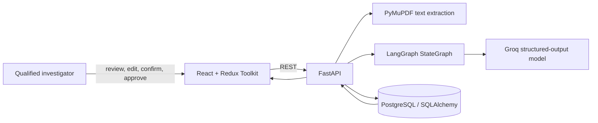
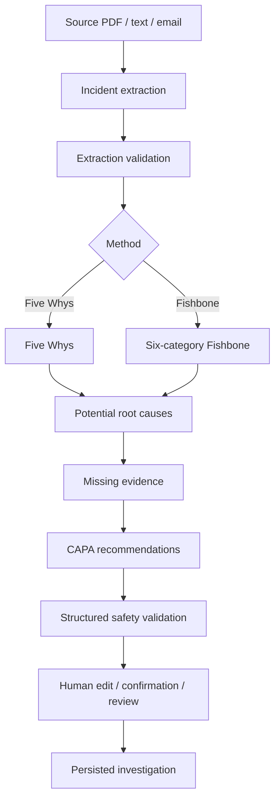

# AIVOA RCA — AI-assisted root cause analysis

A professional, human-reviewed Root Cause Analysis module for pharmaceutical manufacturing investigations. It moves a source incident report through traceable extraction, RCA methodology, evidence collection planning, CAPA recommendations, review, and persisted investigation history.

This is a technical-assignment prototype. It is **not** validated GMP software and does not claim compliance with 21 CFR Part 11 or guarantee product quality or regulatory compliance.

## What is implemented

- React/Vite enterprise workspace with Redux Toolkit state, React Router navigation, responsive desktop/tablet design, editable AI outputs, statuses, loading/error feedback, and investigation history.
- Input by readable PDF (PyMuPDF), pasted report, or email subject/body. PDFs are type/size checked and scanned/empty PDFs receive an actionable error.
- A live Groq integration, configured only on the backend through environment variables. No model output is hard-coded as a final implementation.
- A modular LangGraph `StateGraph`: extract → validate incident → conditionally run Five Whys or Fishbone → candidate causes → missing evidence → CAPA → safety validation.
- Pydantic schemas governing both LLM structured outputs and REST requests/responses.
- SQLAlchemy relational persistence for investigations, details, analysis methods, candidate causes, evidence, CAPA items, and review decisions. PostgreSQL is supplied via Docker; SQLite is permitted only as a local quick-start/smoke-test fallback.
- Human governance: AI causes start as **Suggested**, no numerical pseudo-confidence is shown, confirmation requires an investigator action, and approval requires `QA_APPROVER` (or `ADMIN`) at the API boundary.

## Architecture



### AI workflow



Prompts in `backend/app/ai/prompts.py` prohibit invented facts, preserve figures and units, demand source excerpts where possible, require unknown values to remain unavailable, and prevent automatically confirmed root causes. Each `langchain-groq` call uses Pydantic structured output; malformed results are rejected rather than passed to the browser.

## Project layout

```text
backend/
  app/api/              FastAPI routes
  app/ai/               LangGraph state, nodes, prompts, graph
  app/models.py         SQLAlchemy entities and relationships
  app/schemas.py        Pydantic request, response, and AI contracts
  alembic/              migration environment and initial migration
frontend/src/
  components/           reusable UI and interactive Fishbone diagram
  features/             Redux investigation slice
  pages/                dashboard, input, workspace, review, history
  services/             REST client
sample_data/            Paracetamol temperature-deviation scenario
```

## Run locally

### 1. Start PostgreSQL

```powershell
docker compose up -d db
```

### 2. Configure the backend

```powershell
cd backend
Copy-Item ..\.env.example .env
# edit .env and set GROQ_API_KEY to your own key
python -m venv .venv
.\.venv\Scripts\Activate.ps1
pip install -r requirements.txt
alembic upgrade head
uvicorn app.main:app --reload --port 8000
```

`DATABASE_URL` in `.env.example` targets the Docker PostgreSQL service. For a local non-production smoke test only, set `DATABASE_URL=sqlite:///./rca_ai.db`; startup will create its tables automatically.

`GROQ_MODEL` is configurable and defaults to `openai/gpt-oss-120b`, a currently supported Groq production model. The prior Llama 3.3 70B model is no longer a suitable developer-tier default after its announced 2026 deprecation; configure a model available to your Groq organization. See [Groq’s current model list](https://console.groq.com/docs/models) and [deprecation guidance](https://console.groq.com/docs/deprecations).

### 3. Run the frontend

```powershell
cd frontend
npm install
npm run dev
```

Open `http://localhost:5173`. The Vite client targets `http://localhost:8000/api/v1` by default; set `VITE_API_URL` in `frontend/.env` if needed. Interactive API documentation is at `http://localhost:8000/docs`.

## REST API

| Endpoint | Purpose |
|---|---|
| `POST /api/v1/rca/extract` | Validates PDF/text/email input and extracts structured incident data |
| `POST /api/v1/rca/analyze` | Runs the complete LangGraph workflow |
| `POST /api/v1/rca/five-whys` | Generates/regenerates Five Whys steps |
| `POST /api/v1/rca/fishbone` | Generates six-category contributing factors |
| `POST /api/v1/rca/root-causes` | Generates candidate causes only |
| `POST /api/v1/rca/missing-evidence` | Identifies relevant records to collect |
| `POST /api/v1/rca/capa` | Produces editable correction/corrective/preventive actions |
| `POST /api/v1/investigations` | Persists an investigation |
| `GET /api/v1/investigations` | Lists persisted investigations |
| `GET` / `PUT` / `DELETE /api/v1/investigations/{id}` | Retrieves, updates, or deletes draft investigations |
| `POST /api/v1/investigations/{id}/review` | Save/submit/confirm/approve/reject/return transition |

The review endpoint checks `X-Role`: `approve` is rejected unless the role is `qa_approver` or `admin`. A production deployment should replace this demonstration identity header with authenticated users and audited authorization.

## Demonstration path

1. Start a new investigation and paste `sample_data/paracetamol_temperature_deviation.txt`.
2. Process with AI and review the automatically populated incident form.
3. Select Five Whys or Fishbone and generate the RCA workflow.
4. Review/edit suggestions, evidence states, and CAPA assignments.
5. Save as draft, open Review & approval, submit, then retrieve it from Investigation History.

The sample deliberately mentions no maintenance or sensor-calibration records. Those may be requested as missing evidence, but they are never displayed as proof of a cause.

## Verification performed

- `npm run build` — passed (Vite production build).
- `python -m pytest -q` — passed: FastAPI health endpoint plus real SQLAlchemy create/get/list persistence round trip.
- `alembic upgrade head` — passed against a fresh temporary SQLite database; it created all nine application tables plus the Alembic version table.

Live document extraction and full LangGraph/Groq execution were not run in this workspace because no `GROQ_API_KEY` was supplied. The application returns a clear `503` until one is configured; it never substitutes a mocked AI response. The migration smoke test used SQLite; running it against PostgreSQL still requires the included Docker service (or another configured PostgreSQL instance).

## Known limitations / next production steps

- Add SSO, real user records, immutable audit events, server-side document storage, malware scanning, retention policies, and proper role/permission management.
- Add OCR for scanned PDFs rather than asking the user for extracted text.
- Add integration tests against PostgreSQL and a credentialed, non-production Groq account; evaluate model outputs with a curated, de-identified RCA test set.
- This prototype does not claim validated electronic signatures, audit-trail controls, or regulated-record compliance.
